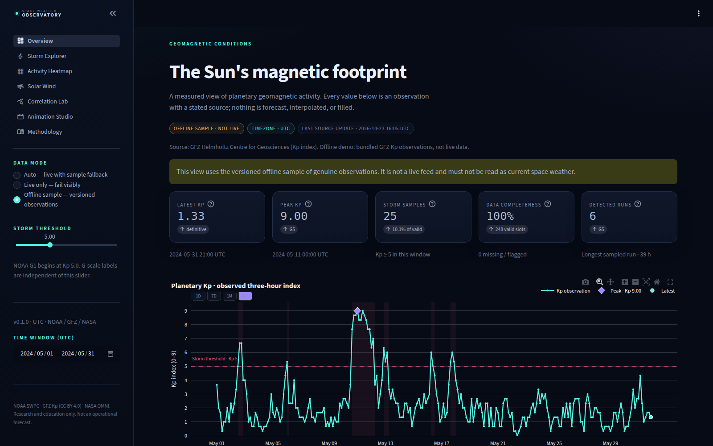
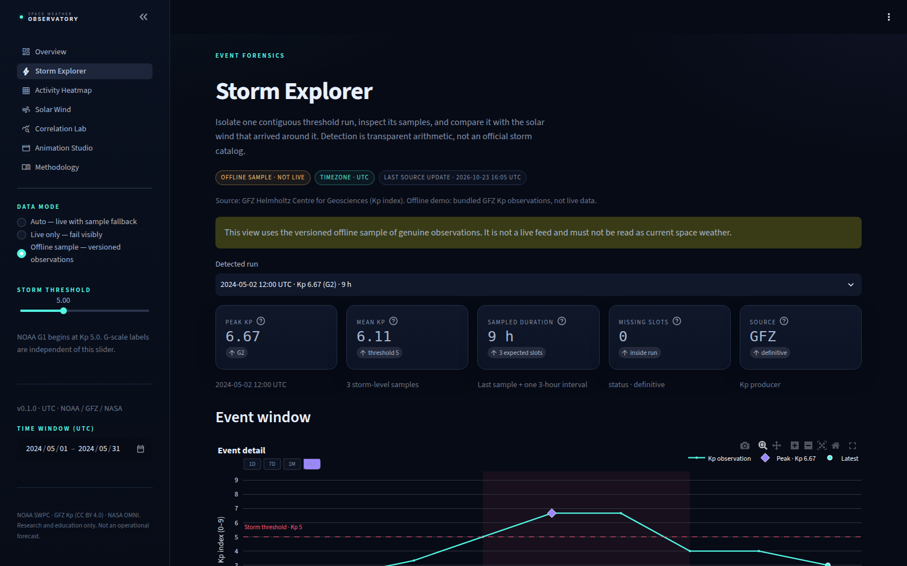
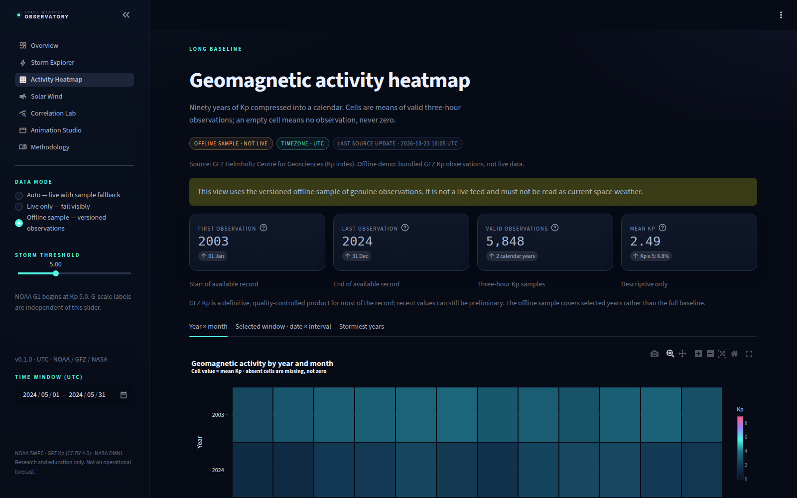
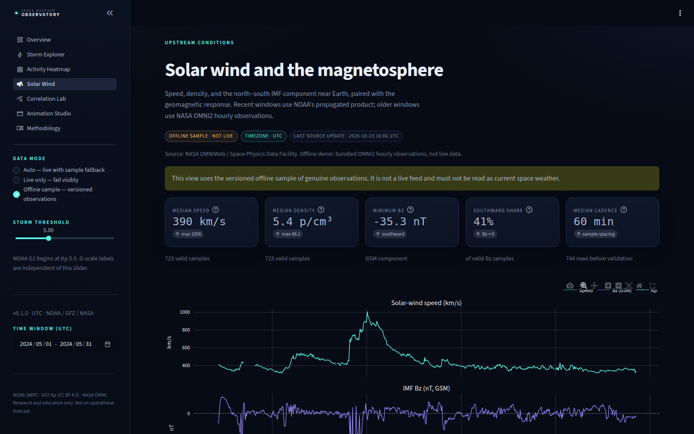
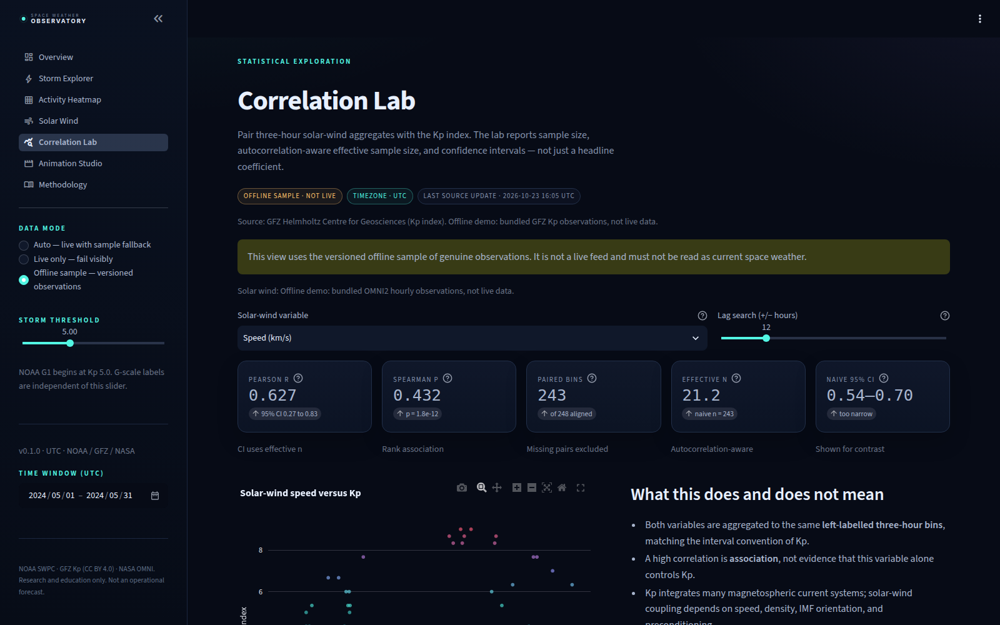
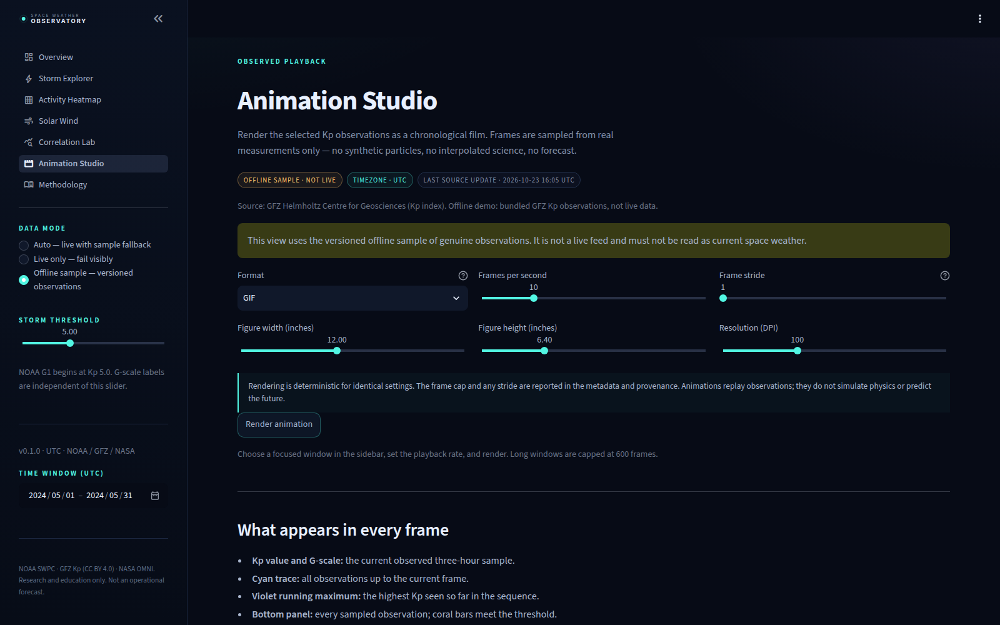

# Space Weather Observatory

**When the Sun disrupts Earth.** An evidence-first, cinematic observatory for geomagnetic storms, the Kp index, and solar-wind conditions — built with Streamlit, real NOAA/GFZ/NASA data, and explicit scientific caveats.

[](https://github.com/Shahbaz2104/space-weather-observatory/actions/workflows/ci.yml)
[](LICENSE)

> This is an educational and exploratory tool. It is **not** an operational forecast service, a civil-protection system, or a substitute for NOAA SWPC alerts.
>
> **Live demo:** <https://space-weather-observatory-4xedxr5f2n5vpym7t5ix7p.streamlit.app/>.
> Deployment notes are in [docs/DEPLOYMENT.md](docs/DEPLOYMENT.md).



## What it does

- **Overview** — current Kp, G-scale status, seven-day activity story, source health, and a compact storm history.
- **Storm Explorer** — threshold-driven storm detection, event metrics, Kp timelines, solar-wind context, and CSV/Parquet/provenance exports.
- **Activity Heatmap** — hour-of-day and year/day structure in the historical Kp record.
- **Solar Wind** — modeled NOAA propagated solar wind, IMF Bz, density, speed, coverage, and aligned Kp.
- **Correlation Lab** — association between three-hour solar-wind aggregates and Kp, with effective sample size, Fisher confidence intervals, and a lag search.
- **Animation Studio** — deterministic observed-Kp animation export with a storm threshold, frame cap, and provenance.
- **Methodology** — conventions, source attribution, limitations, and reproducibility notes.

The project also ships a standalone quickstart that writes a static overview and an animation:

```bash
python main.py                 # live NOAA data, falls back to the bundled sample
python main.py --offline       # genuine bundled observations, no network
python main.py --format mp4    # requires ffmpeg
```

Outputs land in `output/geomagnetic_overview.png` and `output/geomagnetic_story.gif` (or `.mp4`).

## Screenshots

Captured from the running application on 24 October 2026, in **offline sample mode** with the
May 2024 time window. They are genuine screenshots of this interface, not mockups — which is
why every one of them carries the "Offline sample · not live" badge.

| Overview | Storm Explorer |
| --- | --- |
|  |  |
| Latest Kp, peak with G-scale band, threshold counts, completeness, and the observed series. | A single detected run with peak, mean, sampled duration, and missing-slot accounting. |

| Activity Heatmap | Solar Wind |
| --- | --- |
|  |  |
| Mean Kp by year and month; absent cells stay absent. | OMNI2 speed, density, and IMF Bz next to the geomagnetic response. |

| Correlation Lab | Animation Studio |
| --- | --- |
|  |  |
| Pearson/Spearman with effective sample size and Fisher intervals. | Deterministic observed-Kp playback with bounded frames and provenance. |

## Quick start

Requires **Python 3.11+**. Python 3.12 is used in development.

```bash
python3 -m venv .venv
source .venv/bin/activate
pip install --upgrade pip
pip install -r requirements-dev.txt
pip install -e .
streamlit run app.py
```

Open <http://localhost:8501>. The sidebar switches between:

- **Auto** — live sources with a clearly labeled versioned-sample fallback.
- **Live only** — visible failure when a source is unavailable.
- **Offline sample** — real GFZ Kp and NASA OMNI2 observations, not live telemetry.

No API key is required. NASA DONKI is optional and disabled by default.

### Docker

Docker was not available in the development environment used to build this project. The
GitHub Actions `container` job now builds the image, runs it offline, and polls
`/_stcore/health`; local `docker build` and `compose.yaml` runs remain unverified here.

```bash
docker build -t space-weather-observatory .
docker run --rm -p 8501:8501 space-weather-observatory

# or, with named volumes for the cache and exports
cp .env.example .env   # optional
docker compose up --build
```

The image includes `ffmpeg` for MP4 animation export, runs as a non-root user, and has a
health check on `/_stcore/health`. The offline sample is baked in; live mode still needs
outbound network access. Hosted-deployment options and their constraints are in
[docs/DEPLOYMENT.md](docs/DEPLOYMENT.md).

## Data sources

| Source | Product | Cadence | Status | License |
| --- | --- | --- | --- | --- |
| NOAA SWPC | Recent observed planetary K index | 3 h | Preliminary, observed | U.S. Government work, public domain |
| GFZ Helmholtz Centre | Kp and ap since 1932 | 3 h | Definitive | CC BY 4.0; cite Matzka et al. (2021) |
| NOAA SWPC | Seven-day propagated solar wind | 1 min | **Modeled / estimated** | U.S. Government work, public domain |
| NASA OMNIWeb | OMNI2 hourly solar wind and IMF | 1 h | Observed | NASA data guidance; attribution requested |
| NASA DONKI | Space-weather notifications | Event-driven | Observed / modeled mix | Optional, API key required |

The NOAA propagated solar wind is **not a direct in-situ measurement at Earth**. It is a model product and is labeled as such in the interface. OMNI2 is used for historical windows and bundled samples.

See [docs/DATA_SOURCES.md](docs/DATA_SOURCES.md) for endpoints, fallbacks, and limitations.

## Scientific integrity

- **Missing data stays missing.** Nothing is interpolated or zero-filled; solar-wind bins
  carry a sample count and coverage fraction instead.
- **Provenance is a first-class value.** Every number on screen can name its source, its
  retrieval time, and whether it is observed, preliminary, definitive, or modeled.
- **A correlation is not a mechanism.** The lab reports sample size, effective sample
  size, and autocorrelation-aware intervals, and p-values are not corrected for multiple
  comparisons.
- **This is not a warning service.** Detected intervals are a reproducible threshold rule,
  not NOAA storm classifications and not operational alerts.

### Scientific conventions

- **Kp timestamps mark the start of a three-hour interval**, not its midpoint or end.
- **Kp ≥ 5 is G1.** The G-scale badge is an activity classification, not a formal storm warning.
- **Storm duration is the sampled span.** A single qualifying row represents three hours; gaps of one slot are counted as missing inside a run, not silently filled.
- **Preliminary data may be revised.** Recent NOAA Kp and modeled solar wind are marked accordingly.
- **Column-level definitions** for every frame, unit, and status value: [docs/DATA_DICTIONARY.md](docs/DATA_DICTIONARY.md).

See [docs/METHODOLOGY.md](docs/METHODOLOGY.md) for the full definitions.

## Project layout

```text
app.py                     Streamlit entry point and page navigation
pages/                     Seven dashboard pages
src/spaceweather/
  data_sources/            NOAA, GFZ, and OMNI2 adapters and parsers
  ingestion/               HTTP client, cache, validation, sample loader
  processing/              Cleaning, resampling, event detection
  analysis/                Statistics, correlations, anomalies
  visualization/           Plotly/Matplotlib figures and animation
  export/                  Provenance, CSV, Parquet, export bundles
  services.py              Cached orchestration and source fallback
  ui.py                    Shared controls, badges, layout, downloads
scripts/                   Dataset, fetch, and animation CLI wrappers
data/samples/              Versioned genuine observations (offline mode)
tests/                     Unit and integration tests
docs/                      Architecture, methodology, data dictionary, deployment, portfolio
```

Architecture and module responsibilities: [docs/ARCHITECTURE.md](docs/ARCHITECTURE.md).

## Commands

```bash
make run          # streamlit run app.py
make quickstart   # live static PNG + GIF
make fetch        # rebuild processed data and the versioned sample
make animate      # MP4 export
make check        # ruff + mypy + pytest
```

The package also exposes console entry points:

```bash
swo-fetch --skip-processed
swo-animate --offline --format gif --fps 6
```

## Configuration

Copy `.env.example` to `.env`; every setting uses the `SWO_` prefix.

| Variable | Default | Meaning |
| --- | --- | --- |
| `SWO_OFFLINE_MODE` | `false` | Force the bundled sample everywhere |
| `SWO_KP_STORM_THRESHOLD` | `5.0` | Initial storm threshold |
| `SWO_HTTP_TIMEOUT_SECONDS` | `20` | Per-request timeout |
| `SWO_HTTP_RETRIES` | `3` | Retry count |
| `SWO_CACHE_TTL_SECONDS` | `900` | Default HTTP cache lifetime |
| `SWO_DISPLAY_MAX_POINTS` | `5000` | Max points plotted per chart; metrics, events, and exports use all rows |
| `SWO_MAX_ANIMATION_FRAMES` | `600` | Upper bound on rendered frames (app and CLI) |
| `SWO_DEFAULT_ANIMATION_FPS` | `10` | Initial playback rate in Animation Studio |
| `SWO_DEFAULT_ANIMATION_WIDTH` | `12.0` | Initial figure width in inches |
| `SWO_DEFAULT_ANIMATION_HEIGHT` | `6.4` | Initial figure height in inches |
| `SWO_DEFAULT_ANIMATION_DPI` | `100` | Initial render resolution |
| `SWO_NASA_ENABLED` | `false` | Opt in to optional NASA features |
| `SWO_NASA_API_KEY` | empty | API key for NASA services |

Never commit `.env` or API keys.

## Tests and quality gates

```bash
pytest
ruff check .
mypy src
```

The suite covers parsers, missing-data handling, event conventions, correlation statistics, lag direction, provenance serialization, gap-preserving display sampling, sample loading, service-level alignment, and a smoke test of the entry point and all seven pages through Streamlit's `AppTest` harness. Integration tests use the committed genuine-data sample and do not require network access.

## Reproducibility and exports

Every event table and animation export can include a provenance JSON with source URLs, retrieval timestamps, time window, units, transformations, software version, threshold, and warnings. Exports are generated from the exact displayed window; no hidden resampling is performed.

## Performance

There are no claimed speed targets. Measurements are single runs on the development
machine (Python 3.12, Linux), reported as wall time and kept in the evidence log at the
end of [docs/PORTFOLIO.md](docs/PORTFOLIO.md):

| Measurement | How | Result |
| --- | --- | --- |
| Test suite | `pytest -q` | 58 tests in ~16 s |
| App entry point and all seven pages | `AppTest.from_file(...)` in offline mode | 8 scripts, no exceptions, ~11 s total |
| Static quickstart | `python main.py` | PNG + GIF written to `output/` |
| Animation export | `python main.py --offline --format mp4` | 391 frames at 6 fps, 65.2 s video, 1.0 MB, ~3 min 39 s wall time (single run) |
| Server cold start | process start to `/_stcore/health` = 200, offline mode, two runs | 1.5 s and 1.8 s |
| First page build | `AppTest` on `app.py`, then one page, offline mode | 1.5 s for the entry point, ~0.3 s per page script |
| Peak memory | not instrumented | **unmeasured** — not quoted anywhere |

To reproduce the animation timing:

```bash
/usr/bin/time -v .venv/bin/python main.py --offline --format mp4
ffprobe -v error -show_entries format=duration,size -of default=nw=1 output/geomagnetic_story.mp4
```

Interactive page latency is dominated by source retrieval on a cold cache (one HTTP round
per product, then cached for 15 minutes) and by Plotly re-rendering of the selected window.
Charts above `SWO_DISPLAY_MAX_POINTS` (default 5,000) are uniformly subsampled for
rendering, with endpoints and missing-gap boundaries retained so a gap cannot be bridged.
Metrics, event detection, tables, and exports use every row, and the reduction is captioned
under the chart. The animation has its own frame stride, disclosed in the export provenance
and in the Animation Studio output.

## Limitations

- **Recent products are short.** NOAA observed Kp and the propagated solar-wind product
  cover roughly seven days; longer windows use GFZ Kp and OMNI2 instead, so the live
  overview and a historical window are not the same feed.
- **The live solar wind is modeled.** NOAA's propagated product is not an in-situ
  measurement at Earth, and the interface says so on every screen that uses it.
- **Event detection is a rule, not an authority.** Threshold plus gap tolerance reproduces
  no official storm catalogue, and the detected duration is the sampled span.
- **Uncertainty is approximate.** Fisher intervals with an autocorrelation-adjusted sample
  size are a diagnostic, not a time-series model, and no multiple-comparison correction is
  applied.
- **No 3D globe.** A reliable 3D renderer was judged incompatible with the target hosting
  story, so the scientific views are 2D and the field-line/particle ideas stay unbuilt
  rather than faked.
- **Charts reduce very long series.** Above `SWO_DISPLAY_MAX_POINTS` (default 5,000),
  rendering uses a uniform stride plus endpoint and missing-gap boundaries. The trade-off
  is explicit: very short-lived structure between sampled points may be absent from the
  chart, while metrics, detected events, tables, and downloads always use every row.
- **No persistence or accounts.** The app is a stateless single-user tool; exports live in
  the browser session and in `output/`.
- **The container path is verified in CI, not locally.** GitHub Actions builds the image,
  runs it offline, and polls the health endpoint. Docker remains unavailable in this
  development environment. The public Streamlit app serves the styled dashboard from its
  root URL.

## Roadmap

1. Refresh the public screenshots from the deployed instance (no mockups).
2. Superposed-epoch comparison of the October 2003 and May 2024 storms on a common
   day-offset axis.
3. Cross-check detected events against the official NOAA G-scale event list, with explicit
   matching criteria.
4. Optional isolated 3D view, only if a hosting target supports it without sacrificing the
   core pages.
5. Multiple-comparison correction and a block-bootstrap interval for the correlation lab.

## Portfolio materials

[docs/PORTFOLIO.md](docs/PORTFOLIO.md) holds the case study — problem, dataset, engineering
decisions, analytical methods, validation approach, limitations, and next steps — plus a
six-minute interview demo script and draft LinkedIn/CV text. Its figures are traceable to an
evidence log at the end of the file, and anything not measured in this environment is marked
as unmeasured rather than filled in. LinkedIn-ready copy and generated images are in
[docs/LINKEDIN.md](docs/LINKEDIN.md) and `assets/linkedin/`.

## Attribution

- NOAA Space Weather Prediction Center — planetary K-index and solar-wind products.
- GFZ Helmholtz Centre for Geosciences — Kp/ap archive. Matzka, J., Stolle, C., Yamazaki, Y., Bronkalla, O., & Morschhauser, A. (2021). *The geomagnetic Kp index and derived indices of geomagnetic activity*. Space Weather, 19, e2020SW002641. <https://doi.org/10.1029/2020SW002641> (CC BY 4.0).
- NASA Space Physics Data Facility / OMNIWeb — OMNI2 hourly data.

The bundled sample files are genuine observations, not synthetic or live data. See `data/samples/README.md`.

## Citation

Citation metadata lives in [CITATION.cff](CITATION.cff), including the GFZ Kp reference and
the OMNI2 dataset entry:

```bibtex
@software{space_weather_observatory_2026,
  title   = {Space Weather Observatory},
  author  = {Shahbaz},
  year    = {2026},
  version = {0.1.0},
  note    = {MIT licensed. Data: NOAA SWPC, GFZ Kp (CC BY 4.0), NASA OMNIWeb.},
  url     = {https://github.com/Shahbaz2104/space-weather-observatory}
}
```

If you reuse a figure, cite the underlying dataset as well — Kp values come from GFZ
(Matzka et al., 2021, <https://doi.org/10.1029/2020SW002641>) and solar-wind values from
NASA OMNIWeb.

## License

Code is released under the MIT License. Data remain subject to their providers' terms and attribution requirements.
